# 子衿古籍阅读器 | Zijin Guji Reader

免费、无需账户的古籍竖排阅读器。公益站：https://guji.wuyunliuqi.top/ 。

Free, local-first classical Chinese reader with vertical typography, full-text search, bookmarks, notes, export and sharing. No database or backend is required.

## 立即体验 / Try online

**[在线阅读子衿古籍](https://guji.wuyunliuqi.top/)** · [全部50部古籍书目](https://guji.wuyunliuqi.top/catalogue/) · [《黄帝内经》在线阅读](https://guji.wuyunliuqi.top/#read/huangdi-neijing) · [《千字文》详情与下载](https://guji.wuyunliuqi.top/catalogue/qianziwen/)

直接打开浏览器即可免费阅读，不需要注册。手机与电脑均可使用。个人书架、阅读进度和笔记保存在浏览器本地。

## 功能体验 / Features

- **古籍竖排：** 右起竖排，保留注疏、标点和原文位置；支持简繁切换与七种字体。
- **书库和检索：** 经史子集佛道分类、书单、全馆藏全文检索，可定位至章句。
- **个性化阅读：** 字号、纸色、版框、界栏、日夜样式，适配手机与桌面。
- **个人读书：** 书签、选文、笔记、摘录及本地备份，不要求登录。
- **开放分享：** 生成竖排摘录图，支持 TXT、EPUB 下载；按原许可保留版本、来源及署名。

## 实际界面截图 / Screenshots

以下13张图片来自真实运行的公开版（50部馆藏），不是概念设计图。手机为 390 × 844 CSS 像素模拟视口，桌面为 1360 × 860。点击图片可查看原始大图；笔记为演示内容，不是私人数据。

### 手机端 · 浏览与发现 / Mobile discovery

| 书架 | 全部书库 | 古籍分类 |
| :---: | :---: | :---: |
| [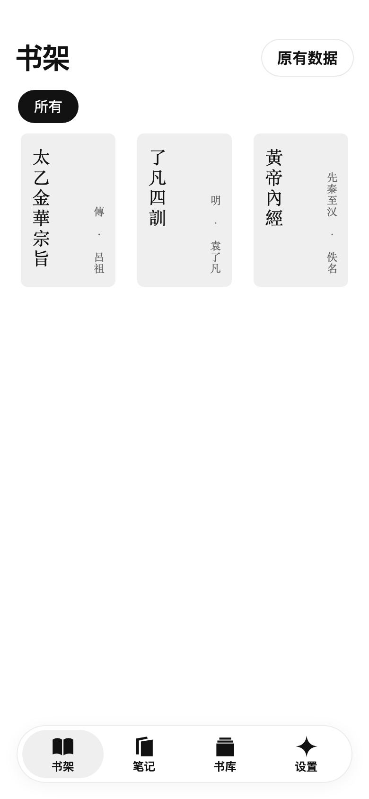](docs/screenshots/01-mobile-shelf.png) | [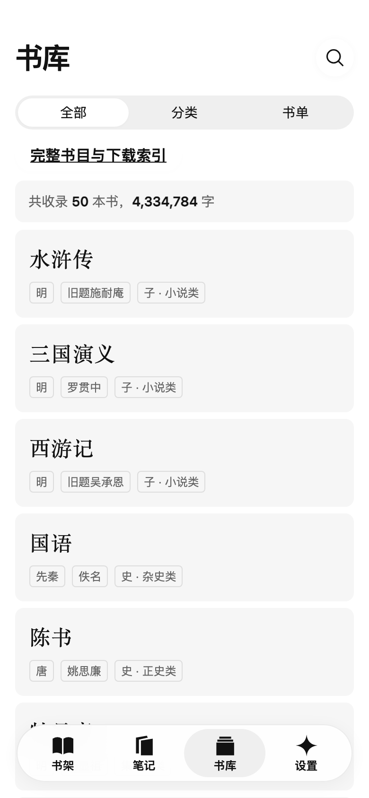](docs/screenshots/02-mobile-library.png) | [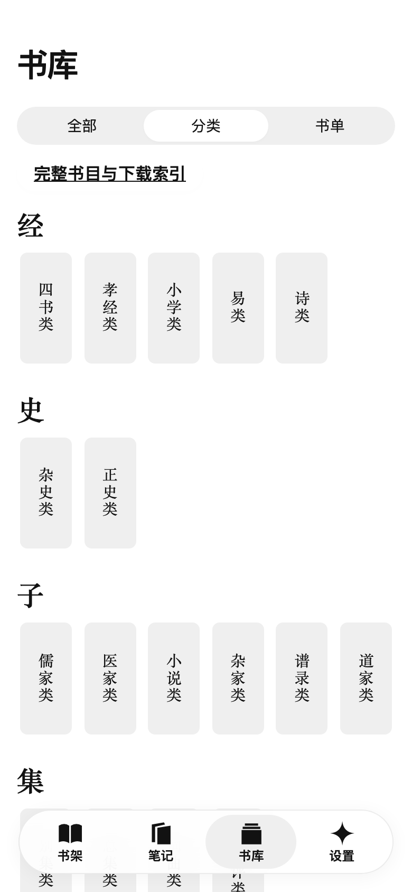](docs/screenshots/03-mobile-categories.png) |

### 手机端 · 沉浸阅读 / Reading and appearance

| 传统竖排 | 字体与简繁 | 纸色与版框 |
| :---: | :---: | :---: |
| [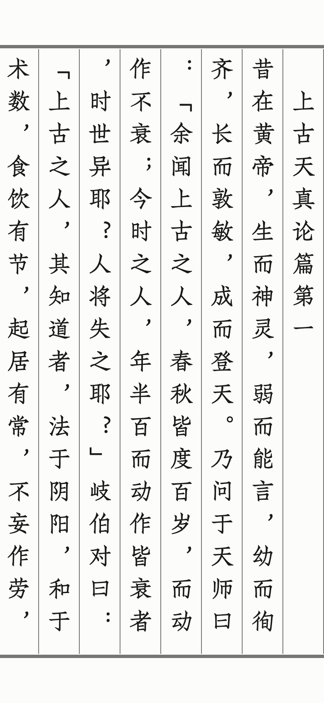](docs/screenshots/05-mobile-reading.png) | [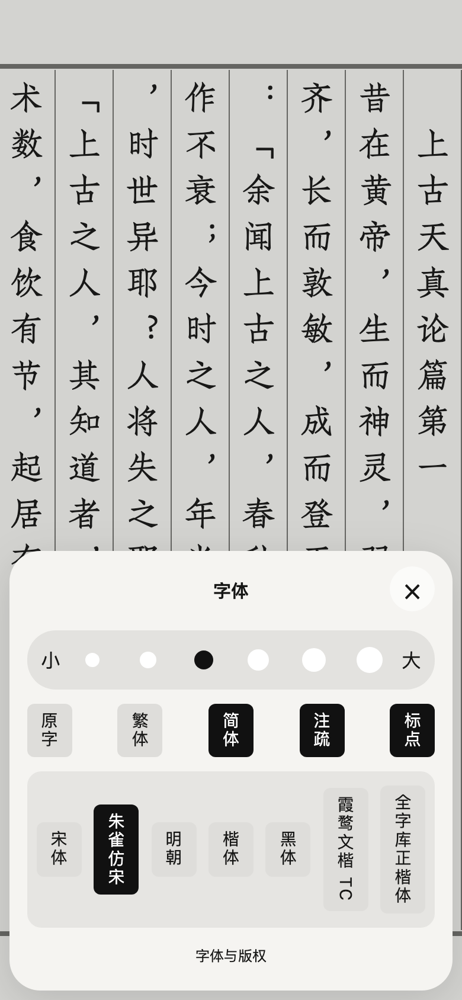](docs/screenshots/06-mobile-fonts.png) | [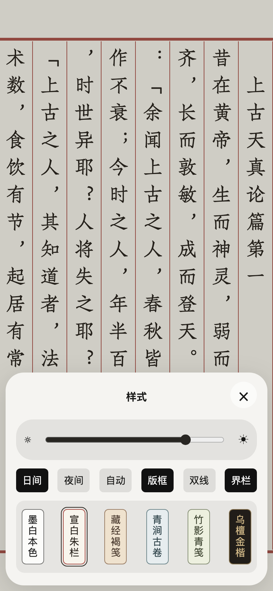](docs/screenshots/07-mobile-theme.png) |

### 手机端 · 检索、笔记和分享 / Search, notes and sharing

| 全文检索 | 读书笔记（演示） | 摘录图预览 |
| :---: | :---: | :---: |
| [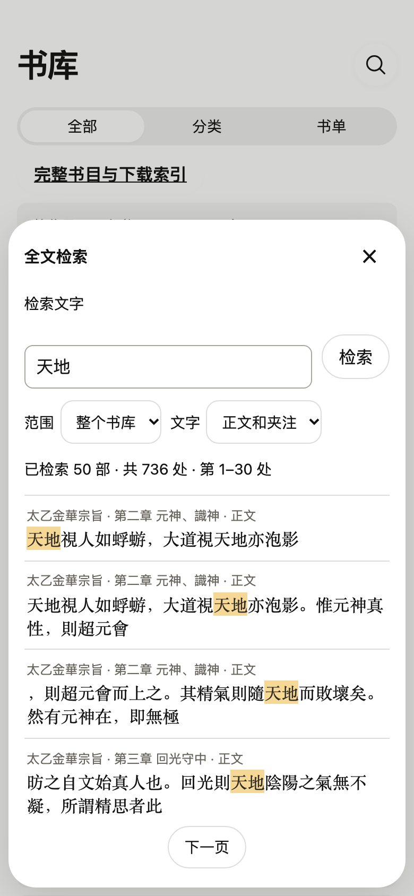](docs/screenshots/04-mobile-search.png) | [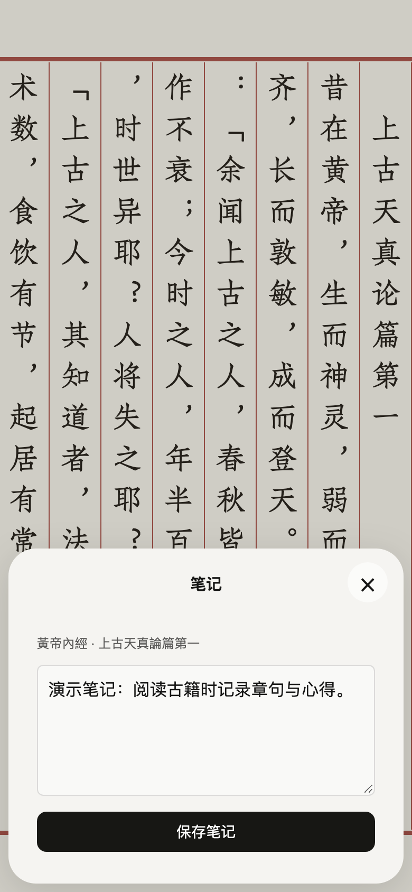](docs/screenshots/08-mobile-note.png) | [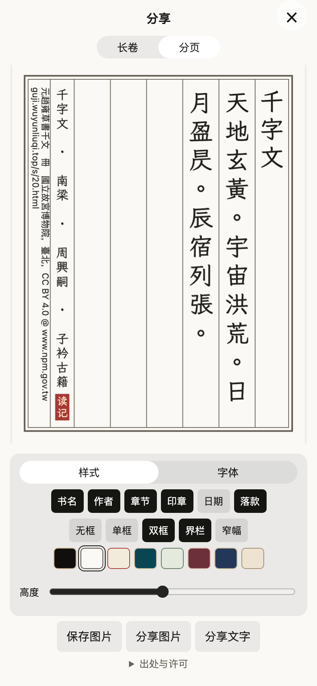](docs/screenshots/09-mobile-share.png) |

实测检索「天地」在当时50部书库中返回736处匹配。分享图由正式官网生成，保留来源与许可。

### 桌面端 · 全宽竖排 / Desktop reading

[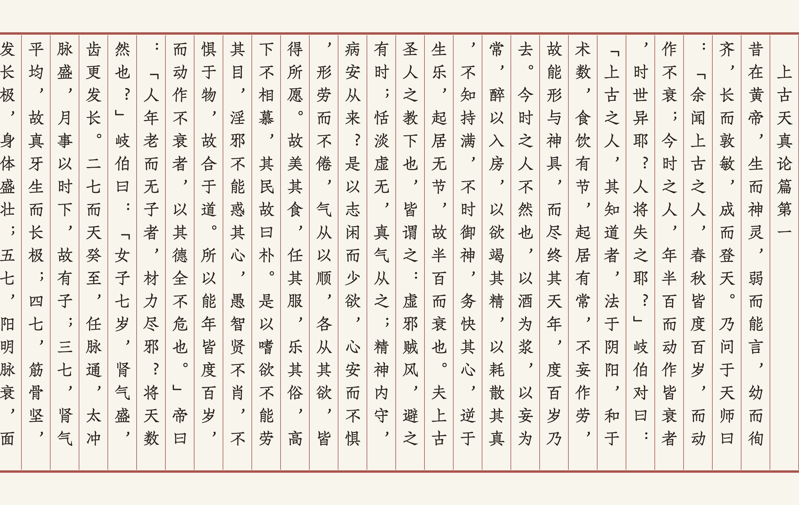](docs/screenshots/12-desktop-reading.png)

| 桌面书库 | TXT / EPUB 导出与来源 |
| :---: | :---: |
| [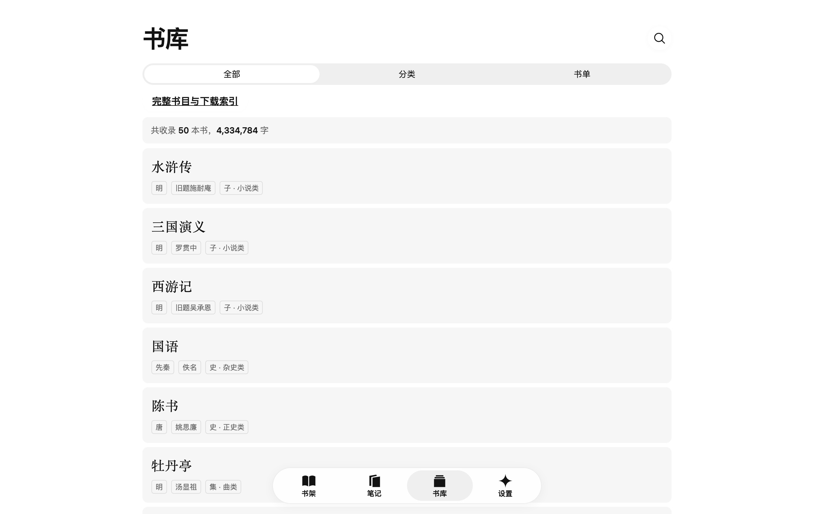](docs/screenshots/11-desktop-library.png) | [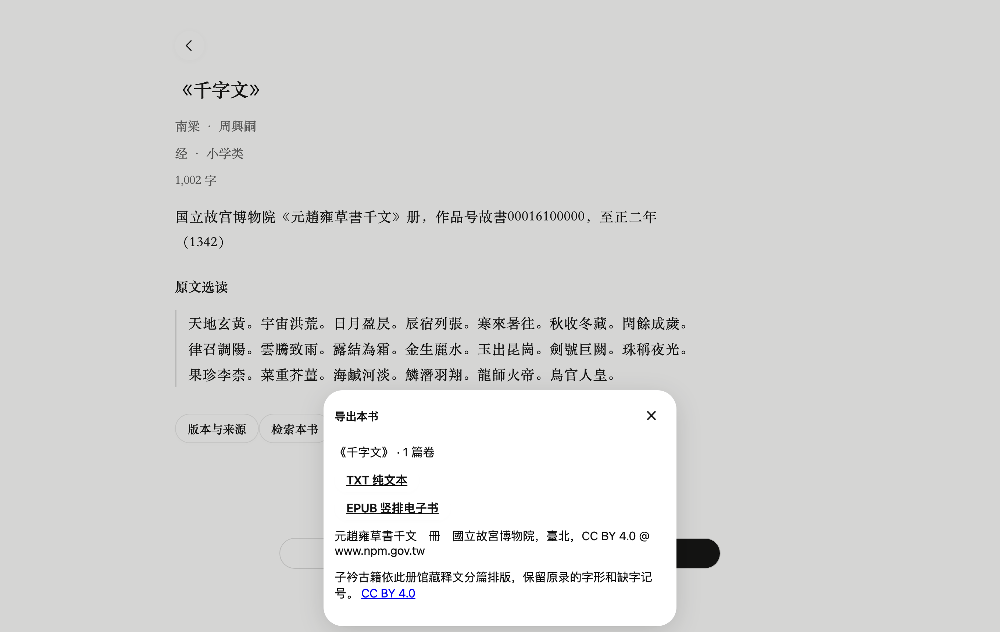](docs/screenshots/13-desktop-export.png) |

### 实际导出的古籍摘录 / Exported quote card

[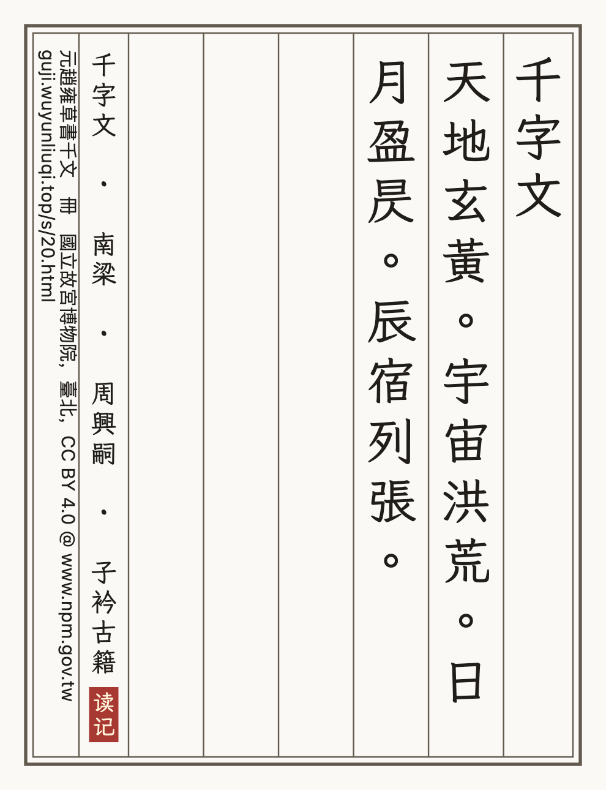](docs/screenshots/10-exported-card.png)

摘录示例：《千字文》「天地玄黃。宇宙洪荒。」原电子文本来源及许可见[版本出处页](https://guji.wuyunliuqi.top/s/20.html)。截图所展示的古籍内容仍遵循各书原许可，字体保留独立许可。详细截图来源见[采集回执](docs/screenshots/capture-receipt.json)。

## 自建 / Self-host
安装 Node.js 22.4+ 与 Python 3（仅本地测试服务器）。没有 npm 运行依赖。

```sh
git clone https://github.com/jingweipro/zijin-guji-reader.git
git clone https://github.com/jingweipro/zijin-guji-data.git
git clone https://github.com/jingweipro/zijin-guji-noncommercial.git
cd zijin-guji-reader
npm run build -- dist ../zijin-guji-data ../zijin-guji-noncommercial
python3 -m http.server 8765 --bind 127.0.0.1 --directory dist
```

访问 http://127.0.0.1:8765/ 。只使用可商用许可的数据时，可省略最后一个数据仓库参数。只构建《千字文》可添加 `--book qianziwen`。输出目录必须不存在，以防误覆盖已有网站。正式托管可上传 dist 的静态文件到支持 HTTPS 的平台；无需连接官方站。使用受信任的、经过授权的数据集，保留来源及许可证；构建检查数据摘要并排除未分发的对校文本。

Build from trusted, licensed data repositories. Choose the 31-book open-data set alone or add the 19-book noncommercial collection only for compatible use. Serve the generated directory over HTTPS or localhost. Reader state is local to the browser; export a backup before changing origins.

## 许可 / License

原创阅读器及构建代码采用 GNU AGPL-3.0-only，见 LICENSE。ICU 转换数据与字体保留各自许可证，见 THIRD_PARTY_NOTICES.md。古籍内容不受软件许可证覆盖；每部古籍保留原始署名和许可。非商业数据不得用于商业用途。本项目不对公有领域古籍原文主张专有权利。

## 测试 / Tests

```sh
npm test
npm run build -- demo ../zijin-guji-data --book qianziwen
npm run test:browser -- demo
```

浏览器测试需要 Chrome/Chromium（可设置 CHROME 路径）。
